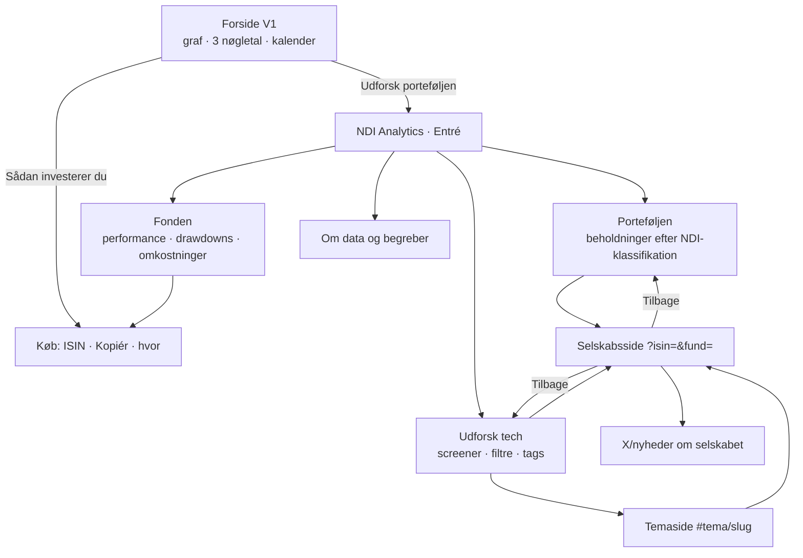

# NDI Analytics – UX-krav til klikbart udkast (aften 15/10-2026)

**Status:** arbejdsdokument til byggeholdet. **Designbeslutninger:** Jesper (mockup + brandpalet). **Kilder:** `vision.txt` (møde 14/10), `slack_ny_graf_2026-10-15.md`, `vendor/graf-v2-*`, `/workspace/ux/` (videnbase = VB, tjekliste = TJ, benchmarks = BM).
**Prioritet:** **MUST** = skal med i aftenens udkast · **SHOULD** = med, hvis tiden tillader det · **COULD** = senere/level 2.
**Palet:** teal `#89aeb4` (primær, outline-knapper) · gul `#f5ee9e` (sparsomt: kun én accent pr. skærm, fx "i porteføljen"-badge eller aktivt filter) · `#050a0f` (baggrund) · `#e6e8ed` (tekst) · `#313a4a` (flader/linjer). Mål kontrasten på hvert par (TJ G1/G2). `#313a4a` er en flade, ikke tekstfarve. Alle grafserier skal have ≥3:1 mod baggrunden.

---

## 0. Uenigheder / bedre idéer
1. **P/S "for alle" giver ikke mening for præ-revenue.** P/S er udefineret eller kæmpestor uden omsætning. **MUST:** vis "– (præ-revenue)" i stedet for et tal, og sorter dem sidst.
2. **"Mistænkt for at være legacy" og "Trump-vindere/-tabere" er holdninger.** Som offentlige tags kan de læses som anbefaling og som politisk stillingtagen om enkeltselskaber. **SHOULD:** lad dem ligge som interne/skjulte tags i udkastet og stil spørgsmålet til compliance (§4). Hvis de skal vises, skal labelen være neutral og forklaret, fx "Politisk følsom eksponering (told/subsidier)".
3. **Afkastkalender med maks. 3 års historik (Jespers kompromis) må ikke skjule dårlige perioder.** Forsiden må gerne vise 3 år, men den fulde historik skal være ét klik væk på porteføljesiden, så nye besøgende også kan finde de dårlige år.
4. **Drawdown-sortering må ikke formuleres som "hvad crashede mest / køb billigt".** Brug neutral label: "Fald fra 52-ugers top". Ingen grøn/rød "mulighed"-farvning.
5. **Ingen nye faner.** Eksisterende kode åbner links med `target="_blank"` (graph.js ~17 steder, company.html `link()`). Interne links (selskab, portefølje, tema) skal åbne i samme fane. Eksterne links kan blive i samme fane med ↗-markering. Det er Jespers beslutning, og ændringen ligger uden for dette dokument (ingen kodeændringer i aften).
6. **Mads' "takes" og AI-nyhedsmails er ikke med i level 1.** Jeg er enig med Mads og Jesper: ingen løbende holdninger pr. aktie og ingen AI-tekst i indbakken nu. Tema-abonnement på mail er COULD (§5).
7. **Kontekstgrafen med Mads' historiske citater (Mattias' idé 2) udskydes.** Der er risiko for cherry-picking. Hvis den laves, skal toppe og bunde dækkes lige meget (Christians krav), og den skal forbi compliance.
8. **Hårdkodede dagsnyheder** (graph.js: `last.d==='2026-10-12'`) bliver forældede uden at nogen opdager det. Alt dag-indhold skal have en datostempel og forsvinde eller markeres "ældre", når datoen ikke er den seneste.

---

## 1. Informationsarkitektur

### 1.1 Sitemap
- **Forside** (`newdealinvest.dk/`, V1, røres ikke i aften): graf, 3 nøgletal, afkastkalender, team, CTA "Sådan investerer du", knap "Udforsk porteføljen" → Analytics. **MUST**
- **NDI Analytics – Entré** (`/graf-v2`, omdøbes senere): tre tydelige "døre" (Mads' hus-metafor) **MUST**
  1. **Fonden** – performance, afkast, drawdowns, omkostninger, sådan investerer du
  2. **Porteføljen** – beholdninger PMINDI/PMINDIAKK, fordelt på NDI-klassifikationer
  3. **Udforsk tech** – screener/tabel med NDI-klassifikationer, temaer og sortering
- **Fonden** (`/graf-v2#fonden`): graf (Jespers version), klassevælger, periode, Nasdaq-100 TR-sammenligning, månedskalender med fuld historik, drawdown-oversigt, ISIN + "Sådan investerer du". **MUST**
- **Porteføljen** (`#portefolje`): beholdningstabel, grupperet efter tema/modenhed, link til selskabsside. **MUST**
- **Udforsk tech / Screener** (`#udforsk`): filtre, tags, sortering og tabel. Level 1 er kun porteføljens selskaber (beslutning fra mødet). **MUST**
- **Temaside** (`#tema/optiske-connects`): hvilket problem temaet løser, hvilke selskaber der indgår, og værdikæden (fx chips → datacenter). **SHOULD**
- **Selskabsside** (`selskab.html?isin=…&fund=…`, eksisterer): problem, rolle i porteføljen, klassifikation, nøgletal, X/nyheder. **MUST**
- **Om data og begreber** (ordliste + datakilder + datostempler). **SHOULD**

### 1.2 Navigation (mermaid)

### 1.3 URL- og state-konventioner
| # | Krav | Prio | Accept |
|---|---|---|---|
| U1 | Al visningstilstand ligger i URL'en: `?fund=pmindi\|pmindiakk&view=fonden\|portefolje\|udforsk&tags=a,b&sort=drawdown52&dir=desc&q=` | MUST | Kopiér URL → åbn i ny browser → identisk visning |
| U2 | Skift af view/fund/filter/sort = `history.pushState`. Skrivning i søgefelt = `replaceState` (ingen historikpost pr. tastetryk) [VB §2, K26] | MUST | Tilbage fjerner seneste filter. Tilbage lukker aldrig siden for tidligt |
| U3 | Selskabsside fra liste → Tilbage lander samme sted i listen med samme filtre og scrollposition [TJ D6, A4] | MUST | Test fra række 20 i screener: retur til række 20 |
| U4 | Overlays/fuldskærmsgraf lukker ved Tilbage. "Vis mere" er ikke en historikpost [TJ A4] | MUST | Åbn fuldskærm → Tilbage → lukket, samme side |
| U5 | Valgt klasse (`fund`) følger med på tværs af alle sider og ind på selskabssiden | MUST | Vælg PMINDIAKK → selskab → tilbage: stadig AKK |
| U6 | Deep link til tema og selskab virker koldt, også i Wix-iframe (bridge `wix-resize.html`) | SHOULD | Direkte link uden forudgående besøg giver korrekt side |
| U7 | Ingen interne links med `target="_blank"` | MUST | `rg target=` viser kun eksterne |
| U8 | Slugs på dansk, små bogstaver, uden æøå (`reindustrialisering-usa`) | SHOULD | – |

### 1.4 Hvad står på hver side (først = det vigtigste) [VB §1, TJ A1]
- **Entré:** én linje om hvad NDI er ("dansk fond der investerer i tech på tværs af sektorer") + de tre døre med beskrivende labels (ikke "Læs mere") + seneste datodato. **MUST**
- **Fonden:** 1) afkast pr. dato + advarsel; 2) graf; 3) kalender inkl. røde måneder; 4) største fald (drawdown) og genopretning; 5) omkostninger (eksisterende `Fondens omkostninger`); 6) ISIN for begge klasser + "Kopiér ISIN" + hvor man kan købe. **MUST**
- **Porteføljen:** tabel med navn først, vægt, klassifikation, tema-tags, P/S og værdiansættelsesklasse, pr. dato. **MUST**
- **Udforsk tech:** filterbar over tabel, aktive filtre som chips, sortering, antal resultater. **MUST**
- **Selskabsside:** 1) hvilket problem selskabet løser (1–2 sætninger); 2) rolle i porteføljen/vægt; 3) NDI-klassifikation og tags; 4) nøgletal (P/S, P/E kun for value) med dato og kilde; 5) kursgraf + 52-ugers top; 6) X/nyheder; 7) eksterne links. **MUST** (1–4, 7), **SHOULD** (5–6)

---

## 2. Brugerrejser

### 2.1 Ny besøgende ("morfar" på 60+, 45 sekunder)
**Mål:** forstå hvad NDI er, se om det har gået godt *og skidt*, og vide hvordan man køber.
1. Lander på forsiden → ser graf + 3 nøgletal + kalender. *Friktion:* for meget tech-jargon, for mange tal. **MUST:** én sætning om fonden over grafen.
2. Ser afkast → advarslen står lige ved tallet. *Friktion:* advarsel gemt i footer. **MUST**
3. Leder efter dårlige perioder → kalender med røde måneder + "største fald". *Friktion:* 3-års-loft skjuler 2022. **MUST:** link "Se hele historikken".
4. "Hvordan køber jeg?" → knappen "Sådan investerer du" i toppen → ISIN for begge klasser, Kopiér, hvor (bank/platform). *Friktion:* skal forstå klasseforskel. **MUST:** én linje om forskellen på PMINDI og PMINDIAKK (udloddende/akkumulerende – verificér ordlyd).
5. Nysgerrig → "Udforsk porteføljen". *Friktion:* bliver væk og kan ikke komme tilbage. **MUST:** U3/U4.

### 2.2 Eksisterende investor (6.000 personer, hurtigt overblik)
**Mål:** "Hvad er der sket?" og "Hvad ejer jeg?"
1. Forside/Fonden → afkast pr. dato for *sin* klasse (klassevælger huskes, U5). **MUST**
2. Månedskalender → denne måned. **MUST**
3. Porteføljen → største positioner og ændringer. *Friktion:* ingen dato på beholdninger. **MUST:** "Beholdning pr. [dato]".
4. Klik på et selskab → hvad laver det, X/nyheder pr. dato. *Friktion:* forventer forklaring af Mads' handler. **MUST:** ingen forklaring af dispositioner (Christian 12/10), kun fakta.
5. Tilbage → samme sted. **MUST**

### 2.3 Analytiker/power user
**Mål:** screene tech efter NDI's linse, ikke efter GICS.
1. Udforsk tech → vælger tema "Optiske connects" + modenhed "highgrowth". **MUST**
2. Sorterer efter "Fald fra 52-ugers top", volatilitet og optrend. **MUST** (drawdown), **SHOULD** (optrend, volatilitet), **COULD** (insiderkøb – kræver datakilde).
3. Ser P/S for alle og P/E kun for value. **MUST**
4. Åbner 3 selskaber efter hinanden og vender tilbage hver gang. *Friktion:* tabt filtertilstand. **MUST:** U1–U3.
5. Deler link med kollega. **MUST:** U1.
6. Eksporterer listen. **COULD** (CSV, se §5).

---

## 3. De vigtigste interaktioner (med acceptkriterier)

### 3.1 Filtre, sortering og tags
| # | Krav | Prio | Accept |
|---|---|---|---|
| I1 | Filtergrupper: Modenhed (præ-revenue / præ-profit / highgrowth / GARP / value), Market cap (small/mid/large), Produktkategori, Temaer | MUST | Hver gruppe kan vælges. Kombination = AND mellem grupper, OR inden for en gruppe. Står i en caption |
| I2 | Tags er mange-til-mange (Tesla både i energi og forbrug) | MUST | Ét selskab kan vises under flere temaer samtidig |
| I3 | Aktive filtre vises som chips over tabellen + "Nulstil alle" [VB §3, TJ C9] | MUST | Antal resultater og chips opdateres med det samme |
| I4 | Toggle "Kun i porteføljen / alle" skjules i level 1 (kun portefølje), men badget "I porteføljen" findes | SHOULD | – |
| I5 | Sortering: navn, vægt, fald fra 52-ugers top, P/S, optrend, volatilitet, insiderkøb | MUST (3 første + P/S), SHOULD (optrend/vol), COULD (insider) | `aria-sort` på aktiv `th`, header er `<button>`, ikon i form og ikke kun farve [TJ C6] |
| I6 | Hver metrik har en synlig definition (fx "Optrend = kurs over 200-dages gennemsnit") | MUST | Definition står i ordliste og ved klik/fokus, ikke kun i hover [VB §9] |
| I7 | Valuation-klasse vises som tekst-badge. P/E kun i value-rækker, ellers "–". P/S for alle undtagen præ-revenue | MUST | Ingen P/E-kolonne for ikke-value. Præ-revenue viser "–" |
| I8 | 0 resultater → tom tilstand med "Fjern seneste filter" | MUST | Se 3.7 |

### 3.2 Grafen (Jespers version, graf-v2)
| # | Krav | Prio | Accept |
|---|---|---|---|
| G1 | Klassevælger PMINDI/PMINDIAKK + perioder som tabs (APG) | MUST | Piletaster virker, `aria-selected`, aktiv ≥3:1 [TJ B4, B9] |
| G2 | Nasdaq-100 TR på samme basis (indekseret), stiplet linje + label | MUST | Kan skelnes i gråtoner [TJ B5, B7] |
| G3 | Synlig tekstpointe under grafen ("PMINDI steg/faldt X % fra … til …, pr. [dato]") + advarsel | MUST | Skærmlæser læser pointen. Data kan hentes som tabel [TJ B8] |
| G4 | Tooltip virker ved tap og fokus og dækker ikke kurven | MUST | Test på 375 px touch [TJ B11] |
| G5 | Drawdown vises (største fald og varighed) | SHOULD | – |
| G6 | Reflow ved 320 px, ingen dobbelt scroll i Wix | MUST | [TJ B12, B13] |

### 3.3 Selskabsside
| # | Krav | Prio | Accept |
|---|---|---|---|
| C1 | Første afsnit = hvilket problem selskabet løser (Mads). Andet = rolle i NDI-porteføljen | MUST | Læses uden scroll på 375 px [TJ D1] |
| C2 | Klassifikation + tags som klikbare chips → screener filtreret | MUST | Klik → screener med det tag i URL |
| C3 | Nøgletal med "pr. dato · kilde" | MUST | Hvert tal har dato [TJ D4] |
| C4 | "Vis mere" ≤2 niveauer, `aria-expanded` | SHOULD | [TJ D2] |
| C5 | Ingen kursmål, prognoser eller "vores take" | MUST | Ordgennemgang: ingen "forventer", "mål", "køb", "undervurderet" |
| C6 | Navnet SoftBank Group er referenceeksemplet (findes i company-library) | MUST | Udkastet demoes med `isin=JP3436100006` |

### 3.4 Søgning
| # | Krav | Prio | Accept |
|---|---|---|---|
| S1 | Ét felt der søger i navn, ticker, ISIN og tema, med synlig søgeknap [VB §3] | MUST | "optisk" finder tema og selskaber |
| S2 | Resultater grupperet: Selskaber / Temaer | SHOULD | – |
| S3 | Ingen træf → forslag (stavning/temaer) | SHOULD | – |

### 3.5 Mobil
| # | Krav | Prio | Accept |
|---|---|---|---|
| M1 | Tabel: sticky header + låst navnekolonne, tydelig vandret scroll (afskåret kolonne) [TJ C3, C4] | MUST | 375 px |
| M2 | Filtre i bottom sheet med "Vis N resultater". Chips forbliver synlige | MUST | Bottom sheet lukker ved Tilbage |
| M3 | Targets ≥24×24 px [TJ G4] | MUST | DevTools-måling |
| M4 | Mobil-standardkolonner: Navn, valuation-klasse, fald fra top. Resten vælges | SHOULD | – |
| M5 | Tilstand overlever afbrydelse (URL) [VB §3] | MUST | Skift app → retur: samme visning |

### 3.6 Tilgængelighed (WCAG 2.2 AA)
- **MUST:** tekstkontrast ≥4,5:1 (teal-på-sort og gul-på-sort skal måles; gul aldrig på lys baggrund) [TJ G1]. Synligt fokus [G3]. Ægte `<table>` [C7]. Farve aldrig eneste kode (op/ned også med ▲▼ og tegn) [B7]. Tabs/disclosure efter APG [G7]. Iframe-title `NewDeal Invest – graf v2` beholdes (bridge afhænger af den). **Accept:** axe 0 kritiske + manuel tab-gennemgang.

### 3.7 Tom-, loading- og fejltilstande
| # | Krav | Prio | Accept |
|---|---|---|---|
| E1 | Loading: skeleton med reserveret højde (Wix monterer sent, 1–13 s) | MUST | Ingen layout-hop. Tekst "Henter data…" |
| E2 | Fejl: klart sprog + "Prøv igen", og sidste gyldige data vises med datostempel | MUST | Sluk netværk → besked, ingen tom kasse |
| E3 | Data ikke valideret (`latest.json validated:false`) → vis forrige gyldige release + "Data pr. [dato]" | MUST | Ingen tal fra en ikke-valideret release |
| E4 | Tom: "Ingen nyheder om [selskab] de seneste 7 dage" / "Ingen selskaber matcher – fjern [filter]" | MUST | [TJ E7, ikke verificeret mod kilde] |

### 3.8 Datostempler
- **MUST:** hvert afkast, kurs, nøgletal, beholdning og X-kort har "pr. [dato]" (format `15. okt. 2026`) [TJ A6, VB §7, BM]. Kilden står ved tallet (Fundmarket/Nasdaq/…).
- **MUST:** siden viser én global "Data opdateret [asOf]" fra `latest.json` (i dag `2026-10-15`).
- **SHOULD:** forskellige datoer på samme side markeres tydeligt (fx beholdning pr. månedsslut og kurs pr. i går).

---

## 4. Compliance-guardrails (designkrav)
| # | Krav | Prio |
|---|---|---|
| R1 | Advarsel om historiske afkast står **lige ved hvert afkasttal** og hver graf, også i kalender og på mobil, ikke kun i footer | MUST |
| R2 | Ingen rådgivningsord: "køb", "sælg", "anbefal", "undervurderet", "mulighed", "bør". Neutrale labels ("Fald fra 52-ugers top") | MUST |
| R3 | Ingen prognoser, kursmål, forventet afkast eller fremskrivninger (ingen fan charts) | MUST |
| R4 | Dårlige perioder er lige så synlige som gode (kalender med røde måneder, største fald). Ingen cherry-picket periode som standard | MUST |
| R5 | Ingen forklaring af fondens daglige dispositioner | MUST |
| R6 | AI-genereret indhold (X/nyheder) markeres som "Automatisk resumé, ikke NDI's vurdering" og har sanity check før visning | MUST |
| R7 | Screener-resultater er "information, ikke en personlig anbefaling" (genbrug eksisterende graph.js-note) | MUST |
| R8 | Ikke-porteføljeselskaber (level 2) mærkes tydeligt "Ikke i porteføljen" | SHOULD |
| R9 | ÅOP/ESMA/PRIIPs bygges **ikke** i aften. Eksisterende omkostningsboks bevares uændret | MUST |

**Åbne spørgsmål til compliance**
1. Hvilken præcis ordlyd og placering kræves for afkastadvarslen ved hvert tal, også i en afkastkalender og ved enkeltaktiers kursudvikling?
2. Må en afkastkalender på forsiden begrænses til 3 år, hvis den fulde historik er ét klik væk?
3. Er offentlige tags som "mistænkt legacy" og "Trump-vinder/-taber" om navngivne selskaber investeringsrådgivning eller anbefaling (MAR/investeringsanbefalinger)?
4. Er en screener med sortering efter drawdown/optrend/insiderkøb markedsføring eller rådgivning? Kræver det en særskilt disclaimer?
5. Må vi vise selskaber, der *ikke* er i fonden (level 2), og hvordan skal det mærkes?
6. Er en valuation-klasse ("value", "GARP" …) en vurdering, der kræver metode og dato?
7. Må AI-resuméer af nyheder vises pr. selskab, og hvilken mærkning kræves?
8. Må "Kopiér ISIN + hvor kan man købe" nævne konkrete banker/platforme?
9. Regler for tema-abonnement på e-mail (samtykke, afmelding, afkasttal i mails)?

---

## 5. Ekstra feature-idéer (prioriteret)
| # | Idé | Hvorfor | Indsats | Prio |
|---|---|---|---|---|
| F1 | **"Hvilket problem løser det?"-kort** øverst på hver selskabs- og temaside | Unikt NDI-perspektiv (bogen), forståeligt for 60+, ingen holdning til kursen | S | MUST |
| F2 | **Livscyklus-strip** (præ-revenue → … → value) med porteføljens selskaber som prikker | Visualiserer modenhed (Mads + bogens kapitel). Findes allerede som graf i velkomstmailen | M | SHOULD |
| F3 | **Værdikæde-visning pr. tema** (chips → fabs → datacenter → software), Mattias' AI-kort i light-version | Det kan man ikke få hos Nordnet/GICS-sites. Giver "fra chips til det, chipsene gør muligt" mening | M (statisk), L (interaktiv tidslinje) | SHOULD/COULD |
| F4 | **"Sådan investerer du"-skuffe** i toppen: ISIN for begge klasser, Kopiér, hvor, klasseforskel | Ny besøgendes vigtigste spørgsmål. Jespers ønske | S | MUST |
| F5 | **Drawdown & genopretning-tabel** for fonden (top-bund-retur) | Viser ærligt de dårlige perioder og opbygger tillid | S | SHOULD |
| F6 | **Delbart link til visning** ("Kopiér link til denne liste") | Power users deler. Gratis, når U1 er på plads | S | SHOULD |
| F7 | **Sparklines i screener** (12 mdr.) | Mindsker recency bias [VB §4, Tufte] | M | COULD |
| F8 | **Tema-abonnement** (Christians mailchimp-tags pr. selskab/tema) | Fastholdelse. Mads: "en feature der holder dem hos os" | M | COULD |
| F9 | **CSV/PDF-eksport** af liste og fondsrapport | Ønsket på mødet ("alt skal kunne hives ned som PDF") | M | COULD |
| F10 | **Ordliste inline** (P/S, GARP, drawdown, optrend) | Fjerner jargon-barriere [VB §9] | S | MUST |
| F11 | **NDI-særmetrikker pr. udvalgt selskab** (à la "Waymo-miles"), kun på 3–5 kerneselskaber | Unikt. Begrænset vedligehold | L | COULD |
